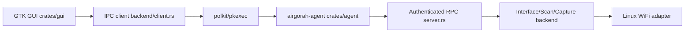

# martin-olivier/airgorah

> Graphical Linux WiFi security audit application, for testing your own networks.

## The problem
Auditing the robustness of a WiFi network you own requires chaining command-line tools, with root rights and a compatible card.

## What it actually does
- GTK4 interface in Rust that captures nearby WiFi traffic and lists access points and clients.
- Can also capture handshakes and PMKIDs, and try to recover an access point's password.
- Privileged operations go through a separate agent (`airgorah-agent`) launched via polkit; the interface stays as a normal user.
- Linux only; WiFi card with monitor mode and packet injection.

## How it is wired


## Trying it
No command in the README: installation and usage are referred to external documentation pages.

```bash
# non documenté dans le README
```

## Cost and gotchas
Free, MIT. Requires a WiFi card compatible with monitor mode and injection. The README states the tool is for networks you own; attacking others is illegal in almost every country.

## What it is not
Not a general-purpose tool: it is strictly offensive/radio audit. It has no link with data or AI. The legal framework (owner's authorization) is the user's responsibility.

## Alternatives
No alternative named in the README.

## For you
Ignore: radio audit tool unrelated to a data / AI / MLOps profile; to be considered only for an authorized test of your own network.
