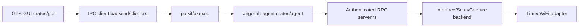

# martin-olivier/airgorah

> Application Linux graphique d'audit de sécurité WiFi, pour tester ses propres réseaux.

## Le problème
Auditer la robustesse d'un réseau WiFi dont on est propriétaire demande d'enchaîner des outils en ligne de commande, avec des droits root et une carte compatible.

## Ce que ça fait vraiment
- Interface GTK4 en Rust qui capture le trafic WiFi proche et liste points d'accès et clients.
- Sait aussi capturer des poignées de main et PMKID, et tenter de retrouver le mot de passe d'un point d'accès.
- Les opérations privilégiées passent par un agent séparé (`airgorah-agent`) lancé via polkit ; l'interface reste en utilisateur normal.
- Linux uniquement ; carte WiFi avec mode moniteur et injection de paquets.

## Comment c'est branché


## Essayer
Aucune commande dans le README : l'installation et l'usage sont renvoyés vers des pages de documentation externes.

```bash
# non documenté dans le README
```

## Coût et pièges
Gratuit, MIT. Exige une carte WiFi compatible mode moniteur et injection. Le README précise que l'outil sert aux réseaux dont on est propriétaire ; attaquer les autres est illégal dans presque tous les pays.

## Ce que ce n'est pas
Ce n'est pas un outil à usage général : il est strictement offensif/audit radio. Il n'a aucun lien avec la data ou l'IA. Le cadre légal (autorisation du propriétaire) est à la charge de l'utilisateur.

## Alternatives
Aucune alternative nommée dans le README.

## Pour toi
Ignorer : outil d'audit radio sans rapport avec un profil data / IA / MLOps ; à ne considérer que pour un test autorisé de son propre réseau.

