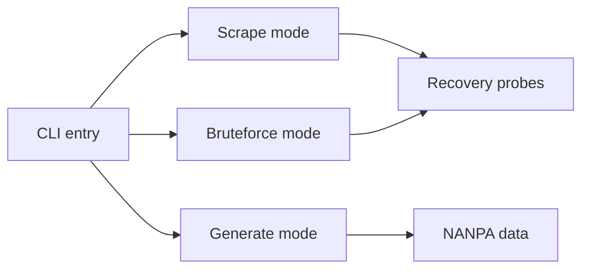

# martinvigo/email2phonenumber

> Proof-of-concept OSINT tool that deduces a phone number from an email address.

## The problem
Password-reset flows display masked digits which, when cross-referenced, can reveal a phone number.

## What it actually does
A single Python script with three modes: `scrape` (extract the digits visible during a reset), `generate` (produce valid numbers from a mask and the numbering plan) and `bruteforce` (test numbers to find the matching masked email, via proxies). The supported sites (eBay, LastPass, Amazon, Twitter) have since added protections, according to the author.

## How it is wired


## Trying it
```bash
pip3 install beautifulsoup4 requests
python3 email2phonenumber.py scrape -e target@email.com
python3 email2phonenumber.py generate -m 555XXX1234 -o /tmp/dic.txt
```

## Cost and gotchas
Free. The described methods no longer work on the listed services; use is subject to authorization and the law.

## What it is not
Not a maintained tool: the author points to "Phonerator". It no longer works as is on the cited sites.

## Alternatives
Phonerator (a more recent tool by the same author, cited in the README).

## For you
Ignore: obsolete proof of concept, last push in July 2024, unrelated to data or MLOps work.
