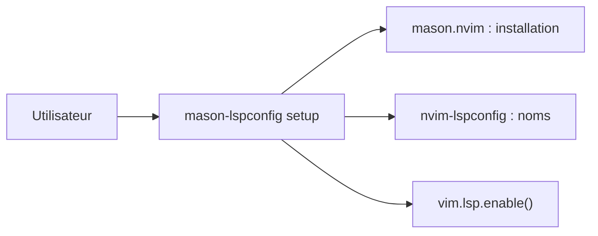

# mason-org/mason-lspconfig.nvim

> Bridge between mason.nvim and nvim-lspconfig to automatically install and enable LSP servers.

## The problem
Matching Mason package names with those of nvim-lspconfig, then enabling each server, is repetitive.

## What it actually does
Translates names between lspconfig and Mason (`lua_ls` ↔ `lua-language-server`), installs the servers in `ensure_installed` and enables them via `vim.lsp.enable()`. Adds `:LspInstall` and `:LspUninstall` and a few server configurations. Since Neovim 0.11 (`vim.lsp.config`), its role has shrunk.

## How it is wired


## Trying it
```lua
{
    "mason-org/mason-lspconfig.nvim",
    opts = { ensure_installed = { "lua_ls", "rust_analyzer" } },
    dependencies = {
        { "mason-org/mason.nvim", opts = {} },
        "neovim/nvim-lspconfig",
    },
}
```

## Cost and gotchas
Free. Neovim ≥ 0.11, mason.nvim ≥ 2.0, nvim-lspconfig ≥ 2.0. Only enables the servers installed by Mason.

## What it is not
Not a server installer (that is mason.nvim) nor the LSP configuration itself.

## Alternatives
No alternative named in the README (native `vim.lsp.config` is enough for a manual setup).

## For you
Worth watching: handy if you want automatic enabling; otherwise the native LSP of Neovim 0.11 already covers the essentials.
