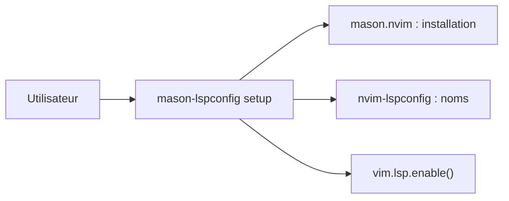

# mason-org/mason-lspconfig.nvim

> Pont entre mason.nvim et nvim-lspconfig pour installer et activer automatiquement des serveurs LSP.

## Le problème
Associer les noms de paquets Mason et ceux de nvim-lspconfig, puis activer chaque serveur, est répétitif.

## Ce que ça fait vraiment
Traduit les noms entre lspconfig et Mason (`lua_ls` ↔ `lua-language-server`), installe les serveurs de `ensure_installed` et les active via `vim.lsp.enable()`. Ajoute `:LspInstall` et `:LspUninstall` et quelques configurations de serveurs. Depuis Neovim 0.11 (`vim.lsp.config`), son rôle s'est réduit.

## Comment c'est branché


## Essayer
```lua
{
    "mason-org/mason-lspconfig.nvim",
    opts = { ensure_installed = { "lua_ls", "rust_analyzer" } },
    dependencies = {
        { "mason-org/mason.nvim", opts = {} },
        "neovim/nvim-lspconfig",
    },
}
```

## Coût et pièges
Gratuit. Neovim ≥ 0.11, mason.nvim ≥ 2.0, nvim-lspconfig ≥ 2.0. N'active que les serveurs installés par Mason.

## Ce que ce n'est pas
Pas un installeur de serveurs (c'est mason.nvim) ni la configuration LSP elle-même.

## Alternatives
Aucune alternative nommée dans le README (`vim.lsp.config` natif suffit pour une config manuelle).

## Pour toi
À surveiller : pratique si tu veux l'activation automatique ; sinon le LSP natif de Neovim 0.11 couvre déjà l'essentiel.

