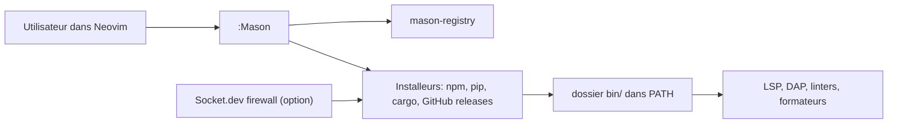

# mason-org/mason.nvim

> Portable package manager for Neovim that installs LSP and DAP servers, linters and formatters.

## The problem
Each language server, linter or formatter is installed by a different tool (npm, pip, cargo, binaries), which complicates editor configuration.

## What it actually does
A Neovim plugin that installs and manages these tools from a single interface. Packages go into Neovim's data folder, and their executables are linked in a `bin/` folder added to the PATH. A central registry (mason-org/mason-registry) provides the list of packages; commands `:Mason`, `:MasonInstall`, `:MasonUpdate`, `:MasonUninstall`. Optional support for the Socket.dev firewall against malicious packages (disabled by default).

## How it is wired


## Trying it
```bash
# Dans Neovim (README) :
# :Mason
# :MasonUpdate
# :MasonInstall <paquet>
# :MasonUninstall <paquet>
# Installation avec lazy.nvim : { "mason-org/mason.nvim", opts = {} }
```

## Cost and gotchas
Free, Apache-2.0. Neovim 0.10 or later, git, curl or wget, unzip, GNU tar, gzip; on Windows pwsh or powershell. It also calls cargo, npm, etc. depending on the packages (`:checkhealth mason`). The README recommends not lazy-loading it.

## What it is not
Not a Neovim plugin manager: it installs external tools, not plugins. It does not replace the configuration of the LSP client.

## Alternatives
None named in the README.

## For you
Worth watching: very useful if you edit Python, YAML or Dockerfiles in Neovim with LSP and linters; without Neovim, no interest.
