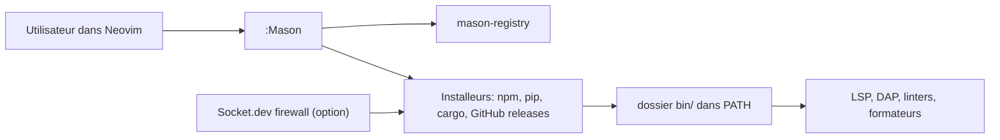

# mason-org/mason.nvim

> Gestionnaire de paquets portable pour Neovim qui installe serveurs LSP et DAP, linters et formateurs.

## Le problème
Chaque serveur de langage, linter ou formateur s'installe par un outil différent (npm, pip, cargo, binaires), ce qui complique la configuration de l'éditeur.

## Ce que ça fait vraiment
Un greffon Neovim qui installe et gère ces outils depuis une seule interface. Les paquets vont dans le dossier de données de Neovim, leurs exécutables sont liés dans un dossier `bin/` ajouté au PATH. Un registre central (mason-org/mason-registry) fournit la liste des paquets ; commandes `:Mason`, `:MasonInstall`, `:MasonUpdate`, `:MasonUninstall`. Support optionnel du pare-feu Socket.dev contre les paquets malveillants (désactivé par défaut).

## Comment c'est branché


## Essayer
```bash
# Dans Neovim (README) :
# :Mason
# :MasonUpdate
# :MasonInstall <paquet>
# :MasonUninstall <paquet>
# Installation avec lazy.nvim : { "mason-org/mason.nvim", opts = {} }
```

## Coût et pièges
Gratuit, Apache-2.0. Neovim 0.10 ou plus, git, curl ou wget, unzip, tar GNU, gzip ; sous Windows pwsh ou powershell. Il appelle aussi cargo, npm, etc. selon les paquets (`:checkhealth mason`). Le README recommande de ne pas différer son chargement.

## Ce que ce n'est pas
Pas un gestionnaire de plugins Neovim : il installe des outils externes, pas des plugins. Il ne remplace pas la configuration du client LSP.

## Alternatives
Aucune nommée dans le README.

## Pour toi
À surveiller : très utile si tu édites du Python, du YAML ou des Dockerfiles dans Neovim avec LSP et linters ; sans Neovim, aucun intérêt.

