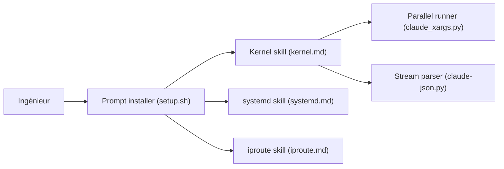

# masoncl/review-prompts

> AI-assisted code review prompts for the Linux kernel, systemd and iproute.

## The problem
An AI reviews demanding system code poorly without knowledge of the bug patterns specific to the kernel or systemd.

## What it actually does
Provides, per project, a skill loaded automatically in the relevant tree, slash commands for review, debugging and verification (/kreview, /kdebug, /kverify...) and knowledge files per subsystem. The kernel also has scripts: a change categorizer, a Claude output parser, a parallel runner. Also targets nfs-utils and pahole according to the code.

## How it is wired


## Trying it
```bash
./setup.sh <agent> <project>
```

## Cost and gotchas
Free, but running it consumes the agent's tokens. Works best with semcode for code navigation.

## What it is not
Not a general-purpose review tool: specialized in system C. The README does not state the measured quality of the reviews.

## Alternatives
No alternative named in the README (it mentions semcode as a complement).

## For you
Ignore: useful only if you review kernel or systemd code; off-topic for data/AI work.
