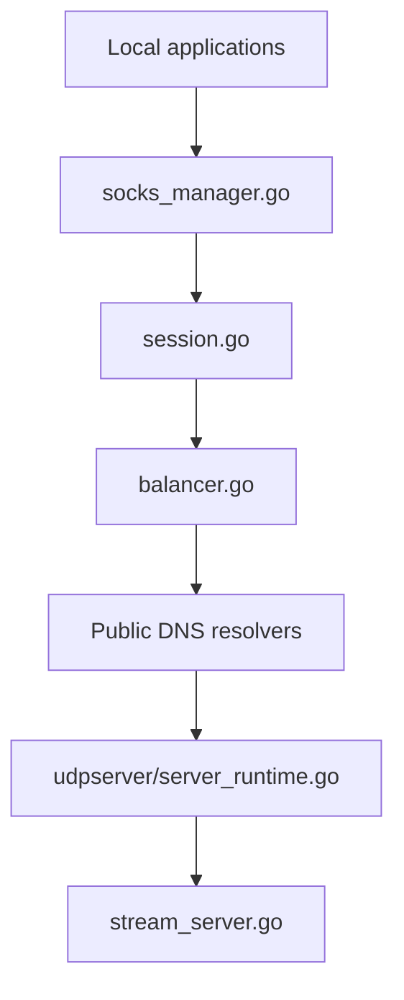

# masterking32/MasterDnsVPN

> DNS tunnel in Go that carries TCP traffic inside DNS requests, for filtered networks.

## The problem
On a network where only DNS gets through, classic VPNs don't work.

## What it actually does
- A client exposes a local SOCKS5/SOCKS4 proxy (or a fixed TCP forward); a server acts as the authoritative DNS for a delegated subdomain.
- Custom protocol with configurable encryption (XOR, ChaCha20, AES-GCM), ARQ, optional compression, multi-resolver selection and duplication, MTU probing.
- The speed gains over DNSTT and SlipStream are those claimed by the author (README table), not verified here.
- No official mobile app.

## How it is wired


## Trying it
```bash
bash <(curl -Ls https://raw.githubusercontent.com/masterking32/MasterDnsVPN/main/server_linux_install.sh)
cp client_config.toml.simple client_config.toml
cp server_config.toml.simple server_config.toml
cp client_resolvers.simple client_resolvers.txt
./masterdnsvpn-server -config server_config.toml
./masterdnsvpn-client -config client_config.toml
```

## Cost and gotchas
You need a server, a domain name with A and NS records, and port 53 free (possible conflict with `systemd-resolved`). The install script is run straight from the network: read it first. The default XOR is the weakest mode.

## What it is not
Not a VPN in the full IP sense: it is a TCP proxy. The README presents it as an educational and research project, and reminds that circumventing local laws may be punished; use it in compliance with applicable law.

## Alternatives
- SlipStream: DNS tunnel over QUIC, in Rust.
- DNSTT: classic DNS tunnel, simpler.

## For you
Watch: interesting for studying tunnel protocols, but unrelated to a data/AI workflow and with unverified performance.
