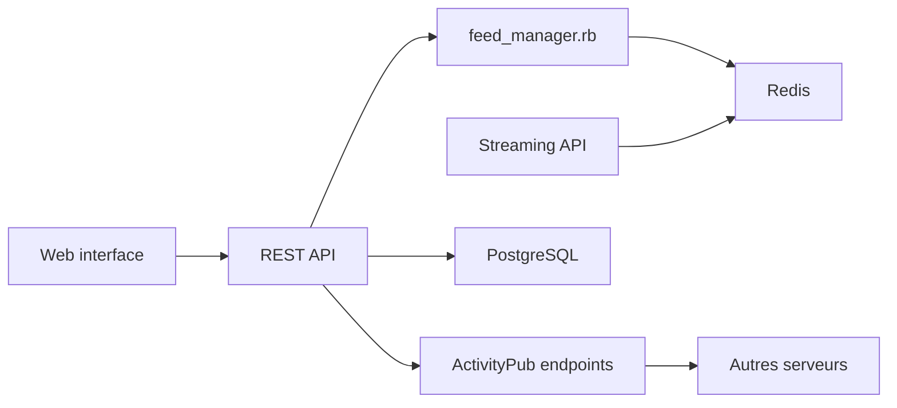

# mastodon/mastodon

> Federated social network server based on ActivityPub, open-source and self-hosted.

## The problem
Centralized social networks trap users and their data; federation allows users to choose their own server while still being able to communicate with others.

## What it actually does
Publication of text, images, and videos, real-time timelines, filtering, moderation, reporting, REST API and OAuth2 for third-party applications. Compatible with any ActivityPub software. Technology stack: Rails, PostgreSQL, Redis, and Sidekiq, Node.js (streaming), React.

## How it is wired

## Trying it
There are no commands in the README: it directs users to the documentation and Docker/docker-compose configuration files in the repository.

## Cost and gotchas
Free; it requires Ruby 4.0, PostgreSQL 14+, Redis 7+, Node 24+, and FFmpeg 5.1+, as well as the responsibility of managing and moderating a public server.

## What it is not
Not a data or AI tool. AGPL-3.0: Any modified code that is made available on a network must be shared.

## Alternatives
No alternative is specified in the README file.

## For you
To ignore: a social media platform that does not involve data or AI, unless a federated node is specifically required.
