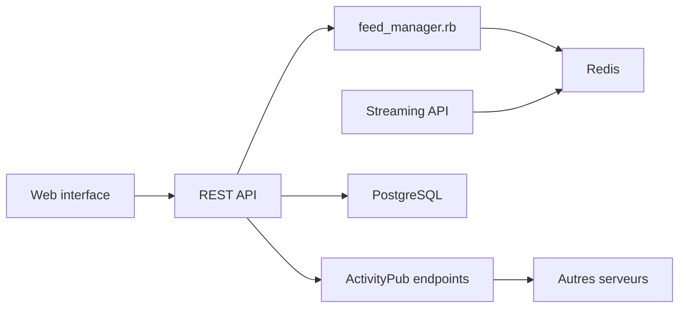

# mastodon/mastodon

> Serveur de réseau social fédéré basé sur ActivityPub, libre et auto-hébergeable.

## Le problème
Les réseaux sociaux centralisés enferment utilisateurs et données ; la fédération permet de choisir son serveur tout en parlant aux autres.

## Ce que ça fait vraiment
Publication de textes, images et vidéos, timelines en temps réel, filtrage, modération, signalement, API REST et OAuth2 pour les applications tierces. Interopérable avec tout logiciel ActivityPub. Pile : Rails, PostgreSQL, Redis et Sidekiq, Node.js (streaming), React.

## Comment c'est branché

## Essayer
Aucune commande dans le README : il renvoie à la documentation et aux configurations Docker/docker-compose du dépôt.

## Coût et pièges
Gratuit ; il faut Ruby 4.0, PostgreSQL 14+, Redis 7+, Node 24+, FFmpeg 5.1+ et la charge d'administrer et modérer un serveur public.

## Ce que ce n'est pas
Pas un outil de données ni d'IA. AGPL-3.0 : le code modifié exposé en réseau doit être partagé.

## Alternatives
Aucune alternative nommée dans le README.

## Pour toi
À ignorer : plateforme sociale sans lien avec la data/IA, sauf besoin précis d'un nœud fédéré.

