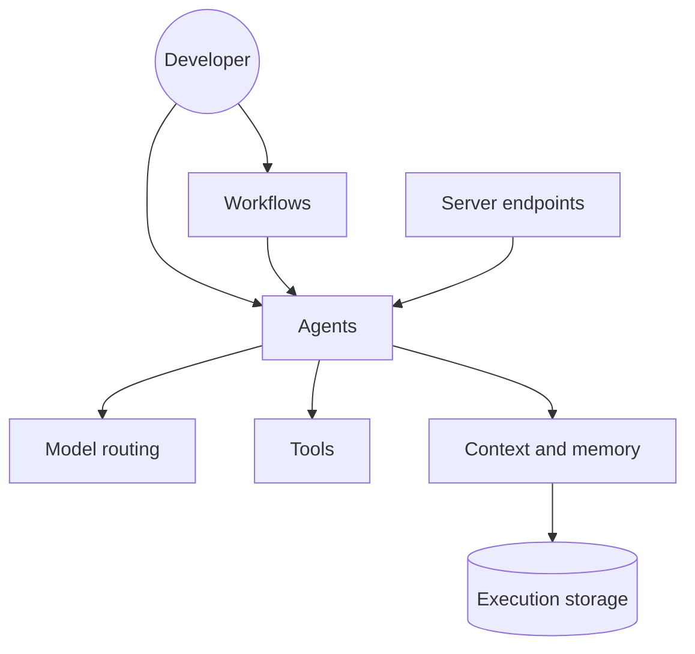

# mastra-ai/mastra

> TypeScript framework for building AI agents and workflows, from idea to production.

## The problem
Building reliable agents in TypeScript means assembling model routing, memory, resume after pause, evaluation and tracing yourself.

## What it actually does
Agents with tools, graph workflows (`.then()`, `.branch()`, `.parallel()`), routing to more than 40 providers, pause for human validation with persisted state, memory and context, MCP servers, React, Next.js and AI SDK integrations, evaluations and observability. A local Studio is provided for testing.

## How it is wired


## Trying it
```bash
npm create mastra@latest
npm create mastra@latest <project-name> -- --llm <provider>
npx bgproc start -n <project-name> -w -- npm run dev
```
Studio at http://localhost:4111.

## Cost and gotchas
Free; model calls are at your expense. The `ee/` folder is under an enterprise license (free in development, license required in production).

## What it is not
Not entirely Apache-2.0: dual license Apache and Mastra Enterprise. GitHub does not identify the license. Not a Python framework.

## Alternatives
None named in the README.

## For you
To adopt if you build agents in TypeScript: full lifecycle coverage, provided you check the `ee/` scope before production.
