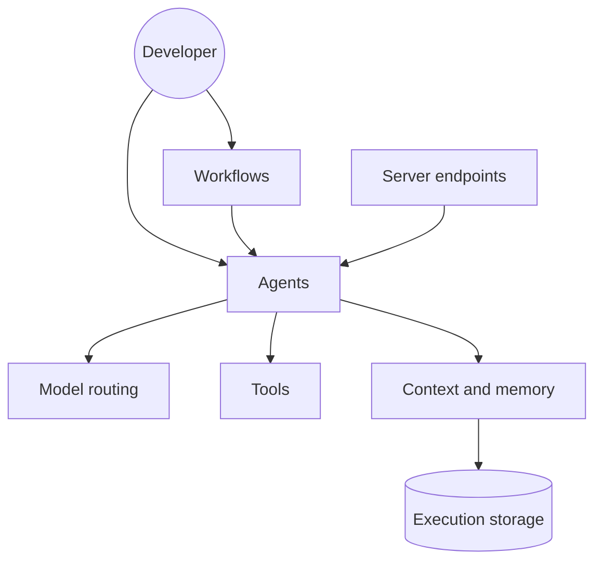

# mastra-ai/mastra

> Framework TypeScript pour construire des agents et workflows IA, de l'idée à la production.

## Le problème
Construire des agents fiables en TypeScript oblige à assembler soi-même routage de modèles, mémoire, reprise après pause, évaluation et traçage.

## Ce que ça fait vraiment
Agents avec outils, workflows en graphe (`.then()`, `.branch()`, `.parallel()`), routage vers plus de 40 fournisseurs, pause pour validation humaine avec état persisté, mémoire et contexte, serveurs MCP, intégrations React, Next.js et AI SDK, évaluations et observabilité. Un Studio local sert à tester.

## Comment c'est branché


## Essayer
```bash
npm create mastra@latest
npm create mastra@latest <project-name> -- --llm <provider>
npx bgproc start -n <project-name> -w -- npm run dev
```
Studio sur http://localhost:4111.

## Coût et pièges
Gratuit ; les appels de modèles sont à ta charge. Le dossier `ee/` est sous licence entreprise (libre en développement, licence requise en production).

## Ce que ce n'est pas
Pas entièrement Apache-2.0 : double licence Apache et Mastra Enterprise. GitHub n'identifie pas la licence. Pas de framework Python.

## Alternatives
Aucune nommée dans le README.

## Pour toi
À adopter si tu fais des agents en TypeScript : couverture complète du cycle, à condition de contrôler le périmètre `ee/` avant la production.

