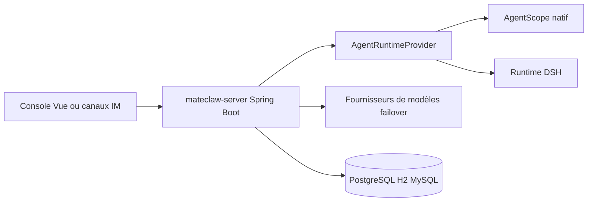

# mateaix/mateclaw

> "Digital employee" AI agent platform for teams, in Java Spring Boot, with audit and approval.

## The problem
Personal AI assistants handle neither multiple users, nor approval of sensitive actions, nor audit, nor failover when a provider goes down.

## What it actually does
The README and the figures (stars, dates, issues) are identical to those of matevip/mateclaw: duplicate or mirror, with no way to know which is the source. Spring Boot 4 and AgentScope backend, native or DSH runtime, switching between model providers, LLM Wiki with citations, durable goals, workflows, skills, MCP and ACP.

## How it is wired


## Trying it
```bash
cp .env.example .env
docker compose up -d
```
Then http://localhost:18080.

## Cost and gotchas
Model keys at your expense. Java 21 and Maven to build. Initial credentials `admin` / `admin123` to be changed. Choose only one of the two twin repositories to avoid divergences.

## What it is not
It is not a lightweight single-user assistant. It is not a distinct project, according to the README: it is identical to matevip/mateclaw.

## Alternatives
The README cites OpenClaw and Hermes Agent, better suited to a single user with file-based configuration.

## For you
Worth watching through just one of the two twin repositories: the governed approach is instructive, but the stack is Java and the repository duplicates matevip/mateclaw.
