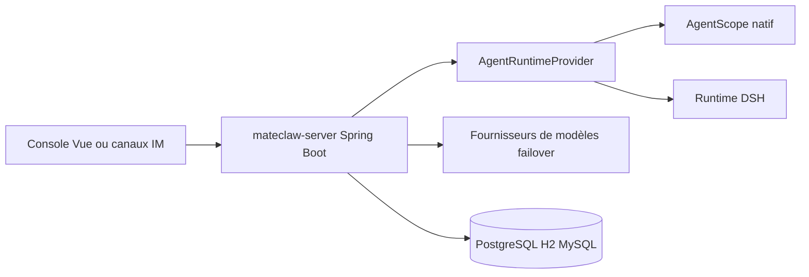

# mateaix/mateclaw

> Plateforme d'agents IA « employés numériques » pour équipes, en Java Spring Boot, avec audit et validation.

## Le problème
Les assistants IA personnels ne gèrent ni multi-utilisateurs, ni validation des actions sensibles, ni audit, ni bascule quand un fournisseur tombe.

## Ce que ça fait vraiment
Le README et les chiffres (étoiles, dates, issues) sont identiques à ceux de matevip/mateclaw : doublon ou miroir, sans qu'on sache lequel est la source. Backend Spring Boot 4 et AgentScope, runtime natif ou DSH, bascule entre fournisseurs de modèles, LLM Wiki avec citations, objectifs durables, workflows, skills, MCP et ACP.

## Comment c'est branché


## Essayer
```bash
cp .env.example .env
docker compose up -d
```
Puis http://localhost:18080.

## Coût et pièges
Clés de modèles à ta charge. Java 21 et Maven pour compiler. Identifiants initiaux `admin` / `admin123` à changer. Choisis un seul des deux dépôts jumeaux pour éviter les divergences.

## Ce que ce n'est pas
Ce n'est pas un assistant mono-utilisateur léger. Ce n'est pas un projet distinct, d'après le README : il est identique à matevip/mateclaw.

## Alternatives
Le README cite OpenClaw et Hermes Agent, plus adaptés à un seul utilisateur en configuration par fichiers.

## Pour toi
À surveiller via un seul des deux dépôts jumeaux : l'approche gouvernée est instructive, mais la pile est Java et le dépôt double matevip/mateclaw.

