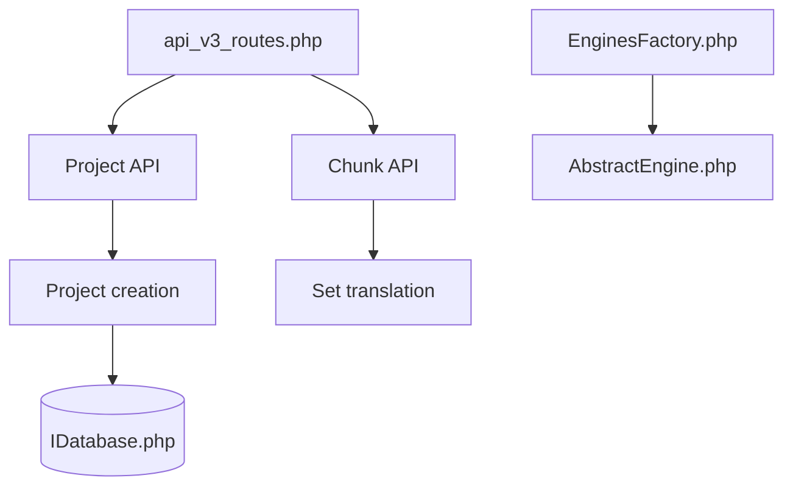

# matecat/MateCat

> Web-based computer-assisted translation tool for translators, project managers and organizations.

## The problem
Translating large volumes with several contributors requires translation memories, machine engines and quality tracking brought together.

## What it actually does
A web platform where you import documents, translate segments with translation memories and machine translation, then review and check quality. It offers an API, quality reports and outsourcing. According to the architecture, data goes into an application database and a file store (S3).

## How it is wired
Diagram based on the one provided, simplified.



## Trying it
```bash
# Installation : voir le guide officiel (site.matecat.com/installation-guide)
yarn watch
yarn build:dev
yarn build:production
```

## Cost and gotchas
Demanding self-hosting (PHP, database, storage, translation engines): the README points to the external guide. A free online version exists at www.matecat.com.

## What it is not
It is not a translation model: it orchestrates third-party engines. Several links in the diagram were not verified in the code.

## Alternatives
No alternative named in the README.

## For you
Ignore: professional translation tool, far from data/AI/MLOps work, unless you have a specific localization need.
