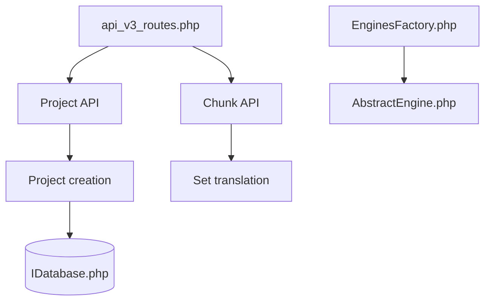

# matecat/MateCat

> Outil web de traduction assistée par ordinateur pour traducteurs, chefs de projet et organisations.

## Le problème
Traduire de gros volumes avec plusieurs intervenants demande mémoires de traduction, moteurs automatiques et suivi de qualité réunis.

## Ce que ça fait vraiment
Plateforme web où l'on importe des documents, traduit des segments avec mémoires de traduction et traduction automatique, puis relit et contrôle la qualité. Elle propose une API, des rapports qualité et de l'externalisation. D'après l'architecture, les données vont dans une base applicative et un stockage de fichiers (S3).

## Comment c'est branché
Schéma d'après le diagramme fourni, simplifié.



## Essayer
```bash
# Installation : voir le guide officiel (site.matecat.com/installation-guide)
yarn watch
yarn build:dev
yarn build:production
```

## Coût et pièges
Auto-hébergement exigeant (PHP, base, stockage, moteurs de traduction) : le README renvoie au guide externe. Une version en ligne gratuite existe sur www.matecat.com.

## Ce que ce n'est pas
Ce n'est pas un modèle de traduction : il orchestre des moteurs tiers. Plusieurs liens du diagramme n'ont pas été vérifiés dans le code.

## Alternatives
Aucune alternative nommée dans le README.

## Pour toi
À ignorer : outil de traduction professionnelle, loin du travail data/IA/MLOps, sauf besoin de localisation précis.

