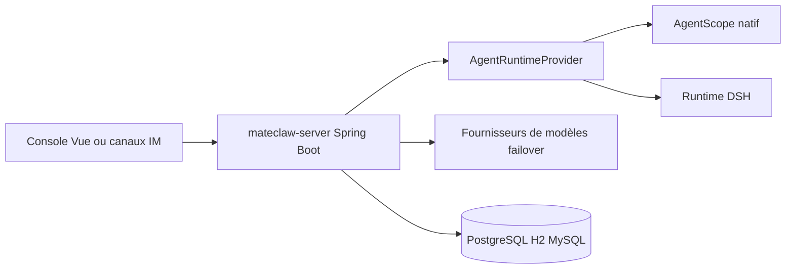

# matevip/mateclaw

> AI-agent "digital employee" platform for teams, built in Java Spring Boot, with audit and approval.

## The problem
Personal AI assistants handle neither multiple users, nor approval of sensitive actions, nor audit, nor failover when a provider goes down.

## What it actually does
Spring Boot 4 backend with AgentScope: each employee has a role, a goal and a runtime (native or DSH). Described features: switching between model providers with health tracking, an LLM Wiki with citations, durable goals resumed after a restart, worker teams, workflows, triggers, SKILL.md skills, MCP and ACP. Web console, Electron app, widget and eight messaging channels.

## How it is wired


## Trying it
```bash
cp .env.example .env
docker compose up -d
```
Then http://localhost:18080.

## Cost and gotchas
Model keys are at your expense. Java 21 and Maven are needed to build. Initial credentials `admin` / `admin123` must be changed. Some runtimes remain unverified on Linux x64 (README).

## What it is not
It is not a lightweight single-user assistant. No exactly-once execution guarantee for external effects (payments, sends). The README's comparison table is written by the author.

## Alternatives
The README cites OpenClaw and Hermes Agent, better suited to a single user with file-based configuration.

## For you
Worth watching: the governed approach (audit, approval, provider failover) is instructive for enterprise agents, if your stack is Java. A twin repository exists (mateaix/mateclaw).
