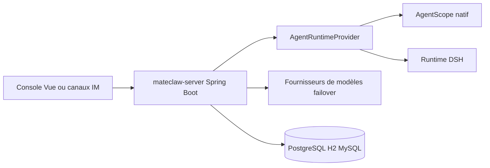

# matevip/mateclaw

> Plateforme d'agents IA « employés numériques » pour équipes, en Java Spring Boot, avec audit et validation.

## Le problème
Les assistants IA personnels ne gèrent ni multi-utilisateurs, ni validation des actions sensibles, ni audit, ni bascule quand un fournisseur tombe.

## Ce que ça fait vraiment
Backend Spring Boot 4 avec AgentScope : chaque employé a un rôle, un but et un runtime (natif ou DSH). Fonctions décrites : bascule entre fournisseurs de modèles avec suivi de santé, LLM Wiki avec citations, objectifs durables repris après redémarrage, équipes de travailleurs, workflows, déclencheurs, skills SKILL.md, MCP et ACP. Console web, application Electron, widget et huit canaux de messagerie.

## Comment c'est branché


## Essayer
```bash
cp .env.example .env
docker compose up -d
```
Puis http://localhost:18080.

## Coût et pièges
Clés de modèles à ta charge. Java 21 et Maven pour compiler. Identifiants initiaux `admin` / `admin123` à changer. Certains runtimes restent non vérifiés sous Linux x64 (README).

## Ce que ce n'est pas
Ce n'est pas un assistant mono-utilisateur léger. Aucune garantie d'exécution unique pour les effets externes (paiements, envois). Le comparatif du README est écrit par l'auteur.

## Alternatives
Le README cite OpenClaw et Hermes Agent, plus adaptés à un seul utilisateur en configuration par fichiers.

## Pour toi
À surveiller : l'approche gouvernée (audit, validation, bascule de fournisseur) est instructive pour des agents en entreprise, si ta pile est Java. Il existe un dépôt jumeau (mateaix/mateclaw).

