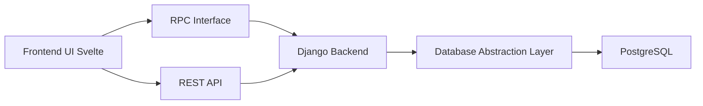

# mathesar-foundation/mathesar

> Spreadsheet-like web interface on top of PostgreSQL, for teams without SQL skills.

## The problem
PostgreSQL databases remain inaccessible to non-technical people without closed or expensive tools.

## What it actually does
Connects to an existing or new Postgres database: spreadsheet view and editing, filters, sorting, grouping, Data Explorer (queries without SQL), forms shared by link, import/export, column migration. Permissions based on Postgres roles. Status: public beta.

## How it is wired

## Trying it
No command in the README: it points to the installation documentation (Docker) and to Mathesar Cloud.

## Cost and gotchas
Self-hosted is free; Mathesar Cloud is in beta with a free plan. Non-profit foundation.

## What it is not
Not a BI tool nor a data warehouse; it works directly on Postgres.

## Alternatives
No alternative cited in the README.

## For you
Worth watching: handy for giving spreadsheet access to a Postgres database of features or labeling.
