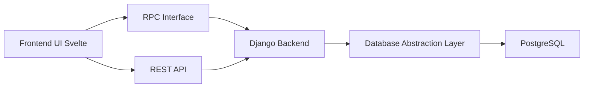

# mathesar-foundation/mathesar

> Interface web type tableur au-dessus de PostgreSQL, pour équipes sans compétences SQL.

## Le problème
Les bases PostgreSQL restent inaccessibles aux non-techniciens sans outils fermés ou coûteux.

## Ce que ça fait vraiment
Se connecte à une base Postgres existante ou neuve : vue et édition en tableur, filtres, tri, regroupement, Data Explorer (requêtes sans SQL), formulaires partagés par lien, import/export, migration de colonnes. Droits basés sur les rôles Postgres. Statut : bêta publique.

## Comment c'est branché

## Essayer
Aucune commande dans le README : il renvoie à la documentation d'installation (Docker) et à Mathesar Cloud.

## Coût et pièges
Auto-hébergé gratuit ; Mathesar Cloud en bêta avec formule gratuite. Fondation à but non lucratif.

## Ce que ce n'est pas
Pas un outil de BI ni un entrepôt de données ; il travaille directement sur Postgres.

## Alternatives
Aucune alternative citée dans le README.

## Pour toi
À surveiller : pratique pour donner un accès tableur à une base Postgres de features ou d'étiquetage.

