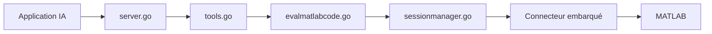

# matlab/matlab-mcp-core-server

> Official MathWorks MCP server to launch MATLAB and run code from an AI application.

## The problem
An AI agent cannot start MATLAB, run code in it or check a script's quality without a dedicated bridge.

## What it actually does
Go binary that drives a MATLAB session (new or existing). Tools: `detect_matlab_toolboxes`, `check_matlab_code` (static analysis), `evaluate_matlab_code`, `run_matlab_file`, `run_matlab_test_file`. Two style-guide resources. Options: initial folder, display mode, extension files for custom tools.

## How it is wired


## Trying it
```bash
claude mcp add --transport stdio matlab -- /fullpath/to/matlab-mcp-server-binary
claude mcp add --transport stdio matlab -- /fullpath/to/matlab-mcp-server-binary --initial-working-folder=/home/username/myproject
codex mcp add matlab -- /fullpath/to/matlab-mcp-server-binary
```

## Cost and gotchas
Requires a MATLAB R2021a or newer installation (paid MathWorks license). Anonymous collection enabled by default (`--disable-telemetry=true`). Single-user use: sharing between users is forbidden without MathWorks' agreement.

## What it is not
Not a free MATLAB nor a shareable server. The license is "present but unidentified": read LICENSE.md.

## Alternatives
No alternative named in the README.

## For you
Worth watching: relevant only if your team already has MATLAB; otherwise of no interest, and check the license clauses before any shared use.
