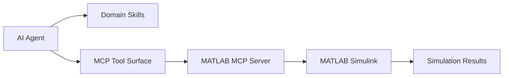

# matlab/simulink-agentic-toolkit

> Skills and MCP tools so agents can read, build and test Simulink models.

## The problem
A general-purpose agent invents Simulink blocks, ignores new features and does not follow model-based design best practices.

## What it actually does
Connects the agent to MATLAB/Simulink through the MATLAB MCP Server. Tools: `model_overview`, `model_read`, `model_edit`, `model_check`, `model_test`, `model_scan`, etc. Grouped skills (modeling, simulation, V&V, code generation, Simscape, real time). MATLAB installer `setupAgenticToolkit`. Claude Code, Copilot, Codex, Amp, Gemini CLI.

## How it is wired


## Trying it
```matlab
setupAgenticToolkit("install")
satk_initialize
openExample('simulink_general/sldemo_househeatExample')
slAgenticTaskExplorer
```

## Cost and gotchas
MATLAB R2023a+ with Simulink, commercial products. `model_test` requires Simulink Test, some skills need other toolboxes. The MCP server must not be shared between users. License not identified by GitHub.

## What it is not
Not usable without a MathWorks license. The Agentic Task Explorer is a research preview that may change.

## Alternatives
The MATLAB Agentic Toolkit, cited for using agents with MATLAB.

## For you
Ignore: reserved for those doing Simulink modeling under a MathWorks license, far from an open data/AI stack.
