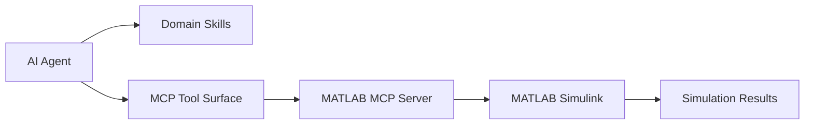

# matlab/simulink-agentic-toolkit

> Skills et outils MCP pour que des agents lisent, construisent et testent des modèles Simulink.

## Le problème
Un agent généraliste invente des blocs Simulink, ignore les nouveautés et ne suit pas les bonnes pratiques de conception par modèle.

## Ce que ça fait vraiment
Branche l'agent sur MATLAB/Simulink via le MATLAB MCP Server. Outils : `model_overview`, `model_read`, `model_edit`, `model_check`, `model_test`, `model_scan`, etc. Skills groupés (modélisation, simulation, V&V, génération de code, Simscape, temps réel). Installeur MATLAB `setupAgenticToolkit`. Claude Code, Copilot, Codex, Amp, Gemini CLI.

## Comment c'est branché


## Essayer
```matlab
setupAgenticToolkit("install")
satk_initialize
openExample('simulink_general/sldemo_househeatExample')
slAgenticTaskExplorer
```

## Coût et pièges
MATLAB R2023a+ avec Simulink, produits commerciaux. `model_test` exige Simulink Test, certains skills d'autres toolboxes. Le serveur MCP ne doit pas être partagé entre utilisateurs. Licence non identifiée par GitHub.

## Ce que ce n'est pas
Pas utilisable sans licence MathWorks. L'Agentic Task Explorer est un aperçu de recherche susceptible de changer.

## Alternatives
Le MATLAB Agentic Toolkit, cité pour utiliser des agents avec MATLAB.

## Pour toi
Ignorer : réservé à ceux qui font de la modélisation Simulink sous licence MathWorks, loin d'un stack data/IA ouvert.

