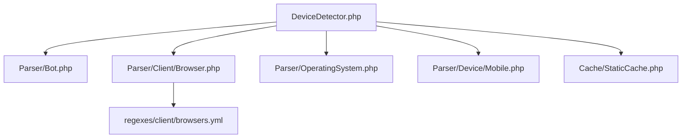

# matomo-org/device-detector

> PHP library that identifies device, browser, system and bot from a user-agent.

## The problem
User-agent strings are numerous and messy; extracting the device or browser type from them takes thousands of rules.

## What it actually does
DeviceDetector parses a user-agent and client hints, then returns bot, client (browser, feed reader, media player), operating system, brand and model. Each parser reads its regexes from YAML files, with a cache (static, PSR-6, PSR-16, Doctrine, Laravel). Ports exist for other languages.

## How it is wired


## Trying it
```bash
composer require matomo/device-detector
./vendor/bin/phpunit
```

## Cost and gotchas
Free, but PHP and Composer are required (missing from the prerequisites list). LGPL-3.0 license: moderate copyleft. Without Composer, you must supply your own YAML reader such as Spyc.

## What it is not
Not an infallible detector: the browser and device lists are generated "from time to time" and may be incomplete.

## Alternatives
Python ports (thinkwelltwd/device_detector, pranavagrawal321/UA-Extract), Go, Rust or Node, listed in the README.

## For you
Ignore unless you analyze web logs in PHP: for Python, a cited port covers the need.
