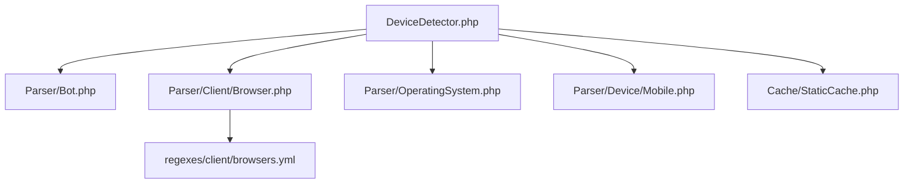

# matomo-org/device-detector

> Bibliothèque PHP qui identifie appareil, navigateur, système et robot à partir d'un user-agent.

## Le problème
Les chaînes user-agent sont nombreuses et désordonnées ; en tirer le type d'appareil ou de navigateur demande des milliers de règles.

## Ce que ça fait vraiment
DeviceDetector analyse un user-agent et des client hints, puis renvoie robot, client (navigateur, lecteur de flux, lecteur média), système, marque et modèle. Chaque parseur lit ses regex dans des fichiers YAML, avec un cache (statique, PSR-6, PSR-16, Doctrine, Laravel). Il existe des portages pour d'autres langages.

## Comment c'est branché


## Essayer
```bash
composer require matomo/device-detector
./vendor/bin/phpunit
```

## Coût et pièges
Gratuit, mais il faut PHP et Composer (absents de la liste des prérequis). Licence LGPL-3.0 : copyleft modéré. Sans Composer, il faut fournir soi-même un lecteur YAML comme Spyc.

## Ce que ce n'est pas
Ce n'est pas un détecteur infaillible : les listes de navigateurs et d'appareils sont générées « de temps en temps » et peuvent être incomplètes.

## Alternatives
Portages Python (thinkwelltwd/device_detector, pranavagrawal321/UA-Extract), Go, Rust ou Node, listés dans le README.

## Pour toi
À ignorer sauf analyse de logs web en PHP : pour du Python, un portage cité couvre le besoin.

