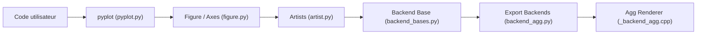

# matplotlib/matplotlib

> The reference Python library for drawing static, animated or interactive figures.

## The problem
Producing reproducible, exportable charts (PDF, SVG, PNG) from Python code, on screen or as files, without depending on a graphical tool.

## What it actually does
`pyplot` or the object API (`Figure`, `Axes`) build a graph of artists in memory.
A backend renders it: GUI (Qt, Tk, GTK, macOS, WebAgg) or export (Agg, PDF, SVG, PS, Cairo, PGF).
Raster rendering, fonts and triangulation go through native C/C++ extensions (`src/`, Agg, FreeType).
Bundled toolkits: `mplot3d`, `axes_grid1`, `axisartist`.

## How it is wired

## Trying it
No installation command in the README: it points to the online installation documentation.

## Cost and gotchas
Free. Native compilation is handled by the wheels; no particular gotcha documented.

## What it is not
Not an interactive web dashboard library. The license is not identified by GitHub in the catalog: to be checked, even though the project is widely distributed.

## Alternatives
No alternative named in the README.

## For you
Worth adopting, it is already your foundation: the de facto standard for analysis and publication figures, interfaced with pandas and most ML tools.
