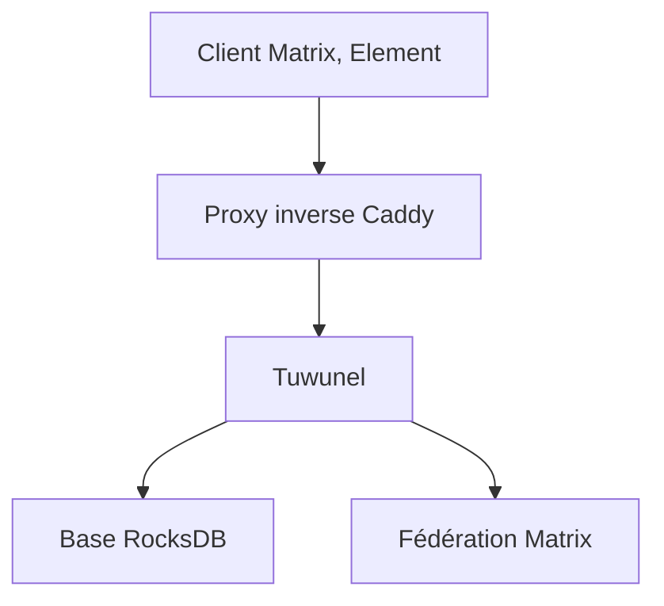

# matrix-construct/tuwunel

> Matrix homeserver written in Rust, alternative to Synapse, successor to conduwuit.

## The problem
Self-hosting Matrix messaging with Synapse demands significant resources and heavy administration.

## What it actually does
Tuwunel implements the Matrix specification to work with the usual clients, bridges and bots. It is distributed as static binaries, deb and rpm packages, Docker images, Arch, Nix, Alpine and Gentoo packages. Configuration goes through `tuwunel-example.toml`, with `server_name` and `database_path`. The first registered account becomes administrator. It migrates in place from conduwuit and Conduit.

## How it is wired
Simplified diagram based on the sheet, no diagram provided.



## Trying it
```bash
docker pull ghcr.io/matrix-construct/tuwunel:latest
caddy reload --config /etc/caddy/Caddyfile
```

## Cost and gotchas
Free; you need a domain name, a TLS certificate and a final `server_name` (impossible to change afterwards). No migration from Synapse for now.

## What it is not
It is not an immediate replacement for Synapse if you already have one: migration is only planned. It is not a data or AI tool.

## Alternatives
Synapse, cited in the README as the server Tuwunel replaces; conduwuit, of which it is the successor.

## For you
Worth watching: useful if you self-host team messaging, but outside the data / AI / MLOps scope.
