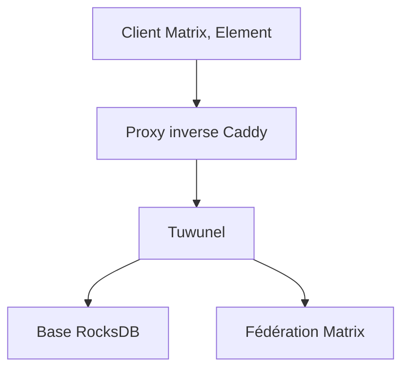

# matrix-construct/tuwunel

> Serveur domestique Matrix écrit en Rust, alternative à Synapse, successeur de conduwuit.

## Le problème
Auto-héberger une messagerie Matrix avec Synapse demande des ressources importantes et une administration lourde.

## Ce que ça fait vraiment
Tuwunel implémente la spécification Matrix pour fonctionner avec les clients, ponts et bots habituels. Il se distribue en binaires statiques, paquets deb et rpm, images Docker, paquets Arch, Nix, Alpine et Gentoo. La configuration passe par `tuwunel-example.toml`, avec `server_name` et `database_path`. Le premier compte enregistré devient administrateur. Il migre en place depuis conduwuit et Conduit.

## Comment c'est branché
Schéma simplifié d'après la fiche, sans diagramme fourni.



## Essayer
```bash
docker pull ghcr.io/matrix-construct/tuwunel:latest
caddy reload --config /etc/caddy/Caddyfile
```

## Coût et pièges
Gratuit ; il faut un nom de domaine, un certificat TLS et un `server_name` définitif (impossible à changer après coup). Pas de migration depuis Synapse pour l'instant.

## Ce que ce n'est pas
Ce n'est pas un remplacement immédiat de Synapse si tu en as déjà un : la migration n'est que planifiée. Ce n'est pas un outil data ou IA.

## Alternatives
Synapse, cité dans le README comme le serveur que Tuwunel remplace ; conduwuit, dont il est le successeur.

## Pour toi
À surveiller : utile si tu auto-héberges une messagerie d'équipe, mais hors du périmètre data / IA / MLOps.

