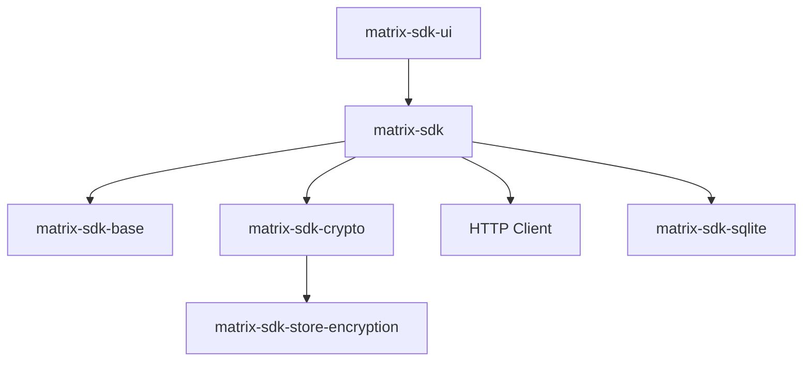

# matrix-org/matrix-rust-sdk

> Rust toolkit for writing Matrix clients, from a simple bot to a full application.

## The problem
A Matrix client has to handle end-to-end encryption, synchronization and room state.

## What it actually does
A set of crates: matrix-sdk-ui (high level, for interfaces), matrix-sdk (mid level for bots and clients) and matrix-sdk-crypto (encryption state machine with no network I/O). The SQLite and IndexedDB stores are separate, and bindings for Swift, Kotlin, JavaScript and Node.js are provided. Element develops and funds the whole, used in Element X.

## How it is wired

## Trying it
No command documented in the README: it points to the examples folder and to the crates' documentation.

## Cost and gotchas
Free; building requires Rust. Only the matrix-sdk-ui, matrix-sdk and matrix-sdk-crypto crates are intended as direct dependencies. The repository has 363 open issues.

## What it is not
It is not a Matrix server or a ready-to-use application. The internal crates are not meant to be used directly.

## Alternatives
No alternative named in the README.

## For you
Worth watching: relevant only for a Matrix bot or connector in Rust; Element's backing gives it longevity.
