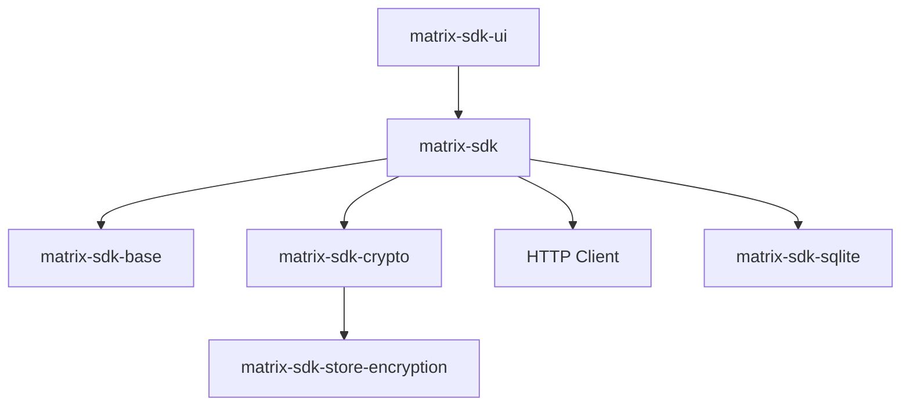

# matrix-org/matrix-rust-sdk

> Boîte à outils Rust pour écrire des clients Matrix, du simple bot à l'application complète.

## Le problème
Un client Matrix doit gérer le chiffrement de bout en bout, la synchronisation et l'état des salons.

## Ce que ça fait vraiment
Un ensemble de crates : matrix-sdk-ui (haut niveau, pour interfaces), matrix-sdk (niveau intermédiaire pour bots et clients) et matrix-sdk-crypto (machine à états de chiffrement sans E/S réseau). Les stockages SQLite et IndexedDB sont séparés, et des liaisons pour Swift, Kotlin, JavaScript et Node.js sont fournies. Element développe et finance l'ensemble, utilisé dans Element X.

## Comment c'est branché

## Essayer
Aucune commande documentée dans le README : il renvoie au dossier examples et à la documentation des crates.

## Coût et pièges
Gratuit ; la compilation demande Rust. Seules les crates matrix-sdk-ui, matrix-sdk et matrix-sdk-crypto sont prévues comme dépendances directes. Le dépôt compte 363 issues ouvertes.

## Ce que ce n'est pas
Ce n'est pas un serveur Matrix ni une application prête à l'emploi. Les crates internes ne doivent pas être utilisées directement.

## Alternatives
Aucune alternative nommée dans le README.

## Pour toi
À surveiller : pertinent seulement pour un bot ou un connecteur Matrix en Rust ; le soutien d'Element lui donne de la durée.

