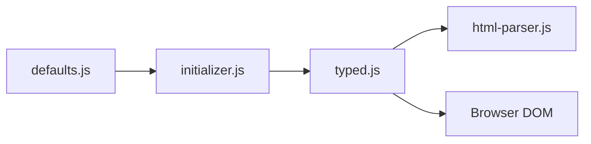

# mattboldt/typed.js

> JavaScript library that simulates animated keyboard typing in a page element.

## The problem
Make text appear letter by letter, with erasing and looping, without writing the timers yourself.

## What it actually does
You create `new Typed('#element', {strings, typeSpeed…})`. The lib initializes the options, types, pauses (`^1000`), erases (with smart erasing), chains sentences, loops. Handles HTML, a customizable cursor, fading, and lifecycle callbacks. React examples, CDN, Vue component and third-party web component.

## How it is wired


## Trying it
```bash
npm install typed.js
```
```js
import Typed from 'typed.js';
const typed = new Typed('#element', { strings: ['<i>First</i> sentence.', '&amp; a second sentence.'], typeSpeed: 50 });
```

## Cost and gotchas
License not identified by GitHub; the README lists GPL-3.0 and commercial licenses (limited or unlimited): commercial use to be clarified before integration.

## What it is not
Not a text generation tool: it is a visual effect.

## Alternatives
No alternative named in the README.

## For you
Cosmetic effect and ambiguous license: of no interest for a data/AI profile.
