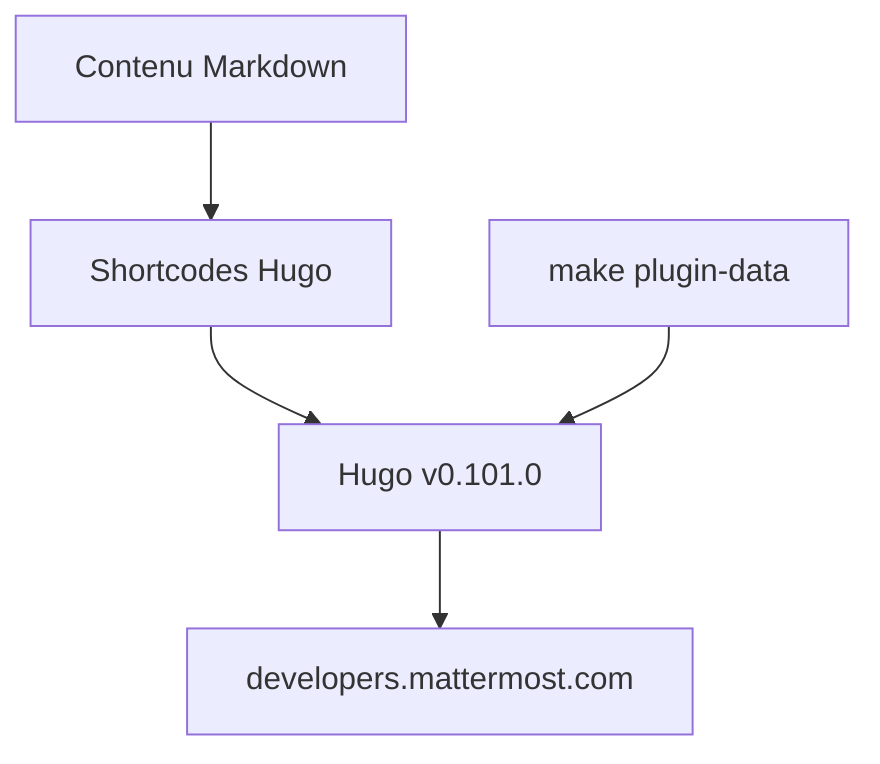

# mattermost/mattermost-developer-documentation

> Hugo site of Mattermost's developer documentation, archived and moved into the main repository.

## The problem
Developers of Mattermost plugins and applications need up-to-date documentation.

## What it actually does
Site built with Hugo v0.101.0, with custom shortcodes: collapse, compass-icon, mermaid, newtabref, note and tabs. The archive points to mattermost/mattermost, docs/develop folder.

## How it is wired
Simplified diagram based on the sheet, no diagram provided.



## Trying it
```bash
make plugin-data
make run
make dist
```

## Cost and gotchas
Go 1.19+, Node 14+ and Hugo to install. Archived repository: do not open issues there anymore.

## What it is not
Not the up-to-date documentation itself: that lives in the main repository.

## Alternatives
- mattermost/mattermost, docs/develop folder: new maintained location.

## For you
Ignore: archived repository, the living source is elsewhere.
