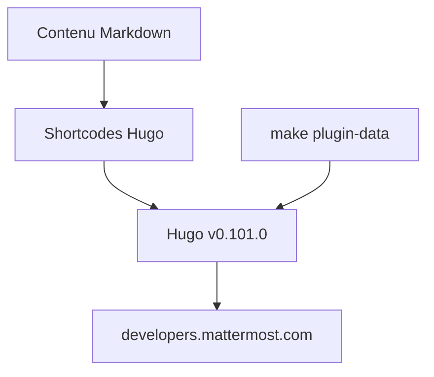

# mattermost/mattermost-developer-documentation

> Site Hugo de la documentation développeur de Mattermost, archivé et déplacé dans le dépôt principal.

## Le problème
Les développeurs de plugins et d'applications Mattermost ont besoin d'une documentation à jour.

## Ce que ça fait vraiment
Site construit avec Hugo v0.101.0, avec des shortcodes maison : collapse, compass-icon, mermaid, newtabref, note et onglets. L'archive renvoie vers mattermost/mattermost, dossier docs/develop.

## Comment c'est branché
Schéma simplifié d'après la fiche, sans diagramme fourni.



## Essayer
```bash
make plugin-data
make run
make dist
```

## Coût et pièges
Go 1.19+, Node 14+ et Hugo à installer. Dépôt archivé : ne plus y ouvrir de tickets.

## Ce que ce n'est pas
Pas la documentation en elle-même à jour : celle-ci est dans le dépôt principal.

## Alternatives
- mattermost/mattermost, dossier docs/develop : nouvel emplacement maintenu.

## Pour toi
Ignorer : dépôt archivé, la source vivante est ailleurs.

