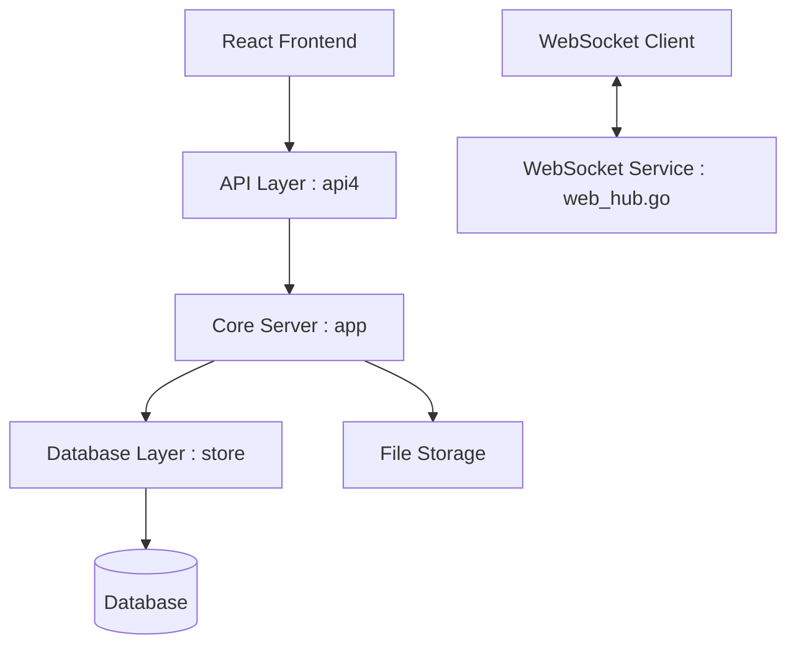

# mattermost/mattermost

> Self-hosted collaboration platform (chat, workflows, calls, AI), for teams that want to keep their data.

## The problem
SaaS team messaging forces you to send your conversations to a third party, which blocks some organizations.

## What it actually does
A single Go server with a React interface, backed by PostgreSQL. It offers chat, automation, voice calls, screen sharing and AI integrations. Mobile and desktop apps exist. A compiled build under the MIT license is released every month on the 16th. The model is "open core".

## How it is wired


## Trying it
```bash
# Aucune commande dans le README.
# Il renvoie aux guides : Docker, Ubuntu, tar, Kubernetes, Helm.
```

## Cost and gotchas
You need a PostgreSQL database and a Linux server to maintain. Some features belong to the paid offering (open core). The repository's license is not identified by GitHub: to be checked.

## What it is not
Not a simple unconditionally free repository: only the monthly compiled build is announced under MIT. Not turnkey: operations and security updates are your responsibility.

## Alternatives
No alternative named in the README.

## For you
Watch: useful if your team wants sovereign internal messaging and agent integrations, otherwise it is not a data / AI tool.
