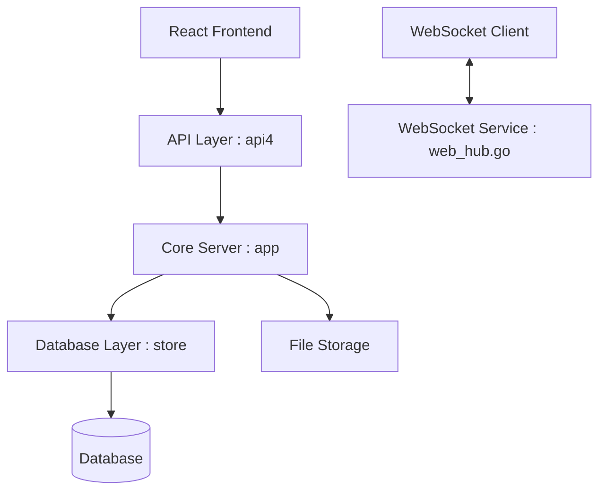

# mattermost/mattermost

> Plateforme de collaboration auto-hébergée (chat, workflows, appels, IA), pour équipes qui veulent garder leurs données.

## Le problème
Les messageries d'équipe SaaS imposent d'envoyer ses conversations chez un tiers, ce qui bloque certaines organisations.

## Ce que ça fait vraiment
Serveur unique en Go avec interface React, qui s'appuie sur PostgreSQL. Il propose chat, automatisation, appels vocaux, partage d'écran et intégrations IA. Des applications mobiles et bureau existent. Une version compilée sous licence MIT sort chaque mois le 16. Le modèle est « open core ».

## Comment c'est branché


## Essayer
```bash
# Aucune commande dans le README.
# Il renvoie aux guides : Docker, Ubuntu, tar, Kubernetes, Helm.
```

## Coût et pièges
Il faut une base PostgreSQL et un serveur Linux à entretenir. Certaines fonctions relèvent de l'offre payante (open core). Licence du dépôt non identifiée par GitHub : à vérifier.

## Ce que ce n'est pas
Pas un simple dépôt libre sans condition : seule la version compilée mensuelle est annoncée sous MIT. Pas clé en main : l'exploitation et les mises à jour de sécurité sont à ta charge.

## Alternatives
Aucune alternative nommée dans le README.

## Pour toi
À surveiller : sert si ton équipe veut une messagerie interne souveraine et des intégrations d'agents, sinon ce n'est pas un outil data / IA.

