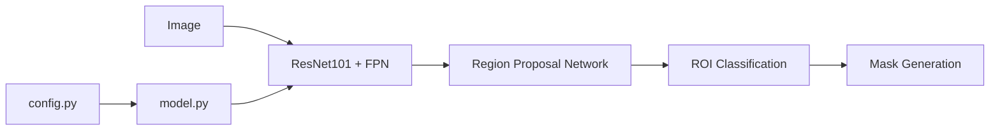

# matterport/Mask_RCNN

> Keras/TensorFlow implementation of Mask R-CNN for instance detection and segmentation.

## The problem
Segmenting every object in an image (box + mask) requires a complex RPN/ROI pipeline that is hard to code and debug.

## What it actually does
Mask R-CNN on FPN + ResNet101, with COCO pre-trained weights and COCO training/evaluation code.
Step-by-step inspection notebooks (anchors, box refinement, masks, activations, weights).
Training on a custom dataset by subclassing `Config` and `Dataset`; `ParallelModel` for multi-GPU.
Documented differences from the paper (resizing, boxes computed from masks, learning rate).

## How it is wired
No readable component provided by the diagram; schema based on the README:


## Trying it
```bash
pip3 install -r requirements.txt
python3 setup.py install
python3 samples/coco/coco.py train --dataset=/path/to/coco/ --model=coco
```

## Cost and gotchas
Pinned to Python 3.4, TensorFlow 1.3, Keras 2.0.8: incompatible with current environments without porting. pycocotools via forks.

## What it is not
Not maintained (last push 2024, 2,022 open issues). Not originally TF2 compatible.

## Alternatives
No alternative named in the README.

## For you
Ignore for a project: obsolete TensorFlow 1 stack; keep only the notebooks as teaching material.
