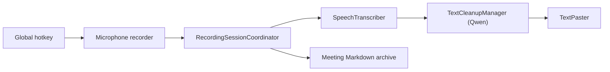

# matthartman/ghost-pepper

> macOS dictation and meeting transcription app that runs entirely locally.

## The problem
Dictation and transcription tools send your voice to a cloud, with a subscription and data leakage.

## What it actually does
You hold Control to speak, then the text is pasted into the active field. Whisper, Parakeet, Qwen3-ASR or Nemotron transcribe locally; a small Qwen LLM cleans up the text. Meeting mode records microphone and system sound, summarizes and writes Markdown. Cloud options (Zo, Trello, Granola, Anthropic) are disabled by default.

## How it is wired


## Trying it
```bash
# Télécharger GhostPepper.dmg, le glisser dans Applications
# Build : ouvrir GhostPepper.xcodeproj dans Xcode, puis Cmd+R
```
Grant the Microphone and Accessibility permissions.

## Cost and gotchas
Free. Apple Silicon and macOS 14+ required. Models weigh from 75 MB to 2.8 GB. No license is declared: usage and redistribution are uncertain.

## What it is not
Not a server-side transcription service. The announced privacy audit is done through AI-assisted code review, not by a third party.

## Alternatives
No alternative named in the README.

## For you
Worth watching if you work on macOS: a good example of local inference, but the absence of a license blocks any reuse.
