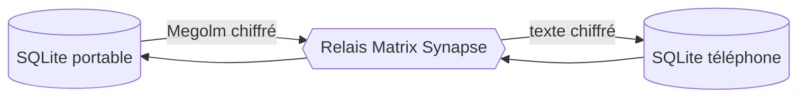

# matthiasn/lotti

> Local-first, end-to-end encrypted journal and task manager, with AI agents that make proposals.

## The problem
Your notes, voice memos and tasks live with a third party who reads them, and AI assistants modify your history without asking.

## What it actually does
Flutter application for macOS, Linux, Windows, iOS and Android. Each device keeps a local SQLite database. Synchronization goes through an encrypted Matrix relay (Synapse), which only sees ciphertext. Agents (tasks, projects, goals, relationships, events) read the record and propose changes that you approve. Transcription runs locally (Whisper or Voxtral). You choose the inference model, using your own key.

## How it is wired


## Trying it
No single command: Flathub (recommended on Linux), AppImage, DMG or APK from the Releases. On Linux, for the AppImage:
```bash
chmod +x Lotti-*-x86_64.AppImage
--appimage-extract-and-run
```

## Cost and gotchas
No Lotti cloud: you need a Matrix relay and, for the agents, a paid inference provider with your key. The local databases are not encrypted by Lotti. No server backup or account recovery.

## What it is not
It is not an effortless hosted service. Entry signing is announced but not yet done. Windows: build from source for now.

## Alternatives
No alternative named in the README.

## For you
Worth watching: a serious example of human-approved agents and local data, which you can study even if you do not adopt the tool.
