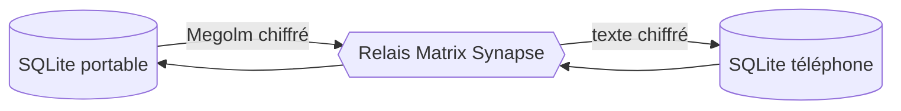

# matthiasn/lotti

> Journal et gestionnaire de tâches local-first, chiffré de bout en bout, avec des agents IA qui proposent.

## Le problème
Tes notes, mémos vocaux et tâches vivent chez un tiers qui les lit, et les assistants IA modifient ton historique sans demander.

## Ce que ça fait vraiment
Application Flutter pour macOS, Linux, Windows, iOS et Android. Chaque appareil garde une base SQLite locale. La synchronisation passe par un relais Matrix (Synapse) chiffré, qui ne voit que du chiffré. Des agents (tâches, projets, objectifs, relations, événements) lisent l'enregistrement et proposent des changements que tu valides. La transcription tourne en local (Whisper ou Voxtral). Tu choisis le modèle d'inférence, via ta clé.

## Comment c'est branché


## Essayer
Aucune commande unique : Flathub (recommandé sous Linux), AppImage, DMG ou APK depuis les Releases. Sous Linux, pour l'AppImage :
```bash
chmod +x Lotti-*-x86_64.AppImage
--appimage-extract-and-run
```

## Coût et pièges
Pas de cloud Lotti : il te faut un relais Matrix et, pour les agents, un fournisseur d'inférence payant avec ta clé. Les bases locales ne sont pas chiffrées par Lotti. Pas de sauvegarde serveur ni de récupération de compte.

## Ce que ce n'est pas
Ce n'est pas un service hébergé sans effort. La signature des entrées est annoncée mais pas encore faite. Windows : compilation depuis les sources pour l'instant.

## Alternatives
Aucune alternative nommée dans le README.

## Pour toi
À surveiller : un exemple sérieux d'agents à validation humaine et de données locales, que tu peux étudier même si tu n'adoptes pas l'outil.

