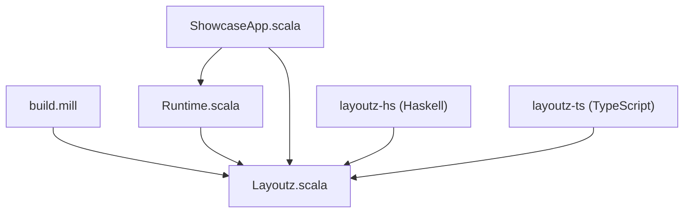

# mattlianje/layoutz

> Small dependency-free Scala library for composing terminal output: tables, charts and Elm-style interfaces.

## The problem
Code that formats and prints text pollutes business logic, especially when it is generated in bulk.

## What it actually does
Layoutz offers a declarative DSL of immutable elements: tables, trees, lists, boxes, ANSI colors, charts (line, bar, pie, heatmap), Kitty images. An Elm-style runtime handles interactive interfaces with file, HTTP and clipboard commands, plus `Ask` prompts and progress bars. It targets Scala 2.12, 2.13 and 3 (JVM, JS, Native).

## How it is wired
Diagram based on the code diagram.


## Trying it
```bash
scala-cli repl --dep xyz.matthieucourt::layoutz:0.8.0
```

## Cost and gotchas
Free. Requires Scala. `LayoutzApp` only works on JVM and Native. Images require a Kitty-compatible terminal.

## What it is not
It is not a tool for Python. It is not a full data visualization framework: the charts stay in the terminal.

## Alternatives
The README cites ScalaTags and Go's bubbletea as inspirations.

## For you
Worth watching: relevant only if you write Scala tools (Spark, for example) that need clean console output.
