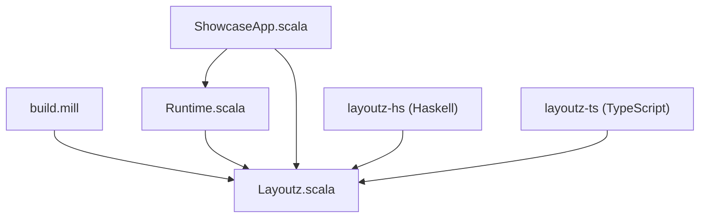

# mattlianje/layoutz

> Petite bibliothèque Scala sans dépendance pour composer des sorties terminal : tableaux, graphiques et interfaces Elm.

## Le problème
Le code qui formate et affiche du texte pollue la logique métier, surtout quand on le génère en masse.

## Ce que ça fait vraiment
Layoutz offre une DSL déclarative d'éléments immuables : tableaux, arbres, listes, boîtes, couleurs ANSI, graphiques (courbes, barres, camembert, heatmap), images Kitty. Un runtime de style Elm gère les interfaces interactives avec commandes de fichier, HTTP et presse-papiers, plus des invites `Ask` et des barres de progression. Elle cible Scala 2.12, 2.13 et 3 (JVM, JS, Native).

## Comment c'est branché
Schéma d'après le diagramme du code.


## Essayer
```bash
scala-cli repl --dep xyz.matthieucourt::layoutz:0.8.0
```

## Coût et pièges
Gratuit. Nécessite Scala. `LayoutzApp` ne fonctionne que sur JVM et Native. Les images demandent un terminal compatible Kitty.

## Ce que ce n'est pas
Ce n'est pas un outil pour Python. Ce n'est pas un framework de visualisation de données complet : les graphiques restent dans le terminal.

## Alternatives
Le README cite comme inspirations ScalaTags et bubbletea de Go.

## Pour toi
À surveiller : pertinent seulement si tu écris des outils Scala (Spark, par exemple) qui ont besoin d'une sortie console propre.

