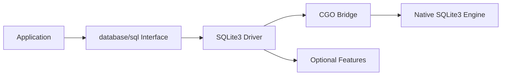

# mattn/go-sqlite3

> SQLite3 driver for Go, compliant with the database/sql interface, via cgo.

## The problem
Use SQLite from Go with the standard `database/sql` library.

## What it actually does
A cgo driver that embeds SQLite. The connection string exposes options (journal, locking, foreign keys, cache, time zone, `_txlock`...); extensions (FTS5, JSON, math, ICU, vtable, security) are enabled through build tags. User authentication is marked as deprecated.

## How it is wired


## Trying it
```bash
go get github.com/mattn/go-sqlite3
go build -tags "icu json1 fts5 secure_delete"
```

## Cost and gotchas
Free, MIT. Requires `CGO_ENABLED=1` and a gcc compiler in the PATH: cross-compilation is complicated. Concurrent writes are tricky: "database is locked".

## What it is not
Not a pure Go driver, and the README does not present it as suited to concurrent writes.

## Alternatives
No alternative named in the README.

## For you
Keep an eye on it: the reference for SQLite in Go; outside Go, irrelevant.
