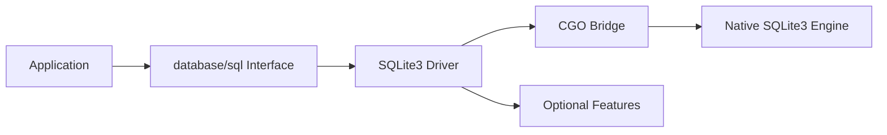

# mattn/go-sqlite3

> Pilote SQLite3 pour Go, conforme à l'interface database/sql, via cgo.

## Le problème
Utiliser SQLite depuis Go avec la bibliothèque standard `database/sql`.

## Ce que ça fait vraiment
Un pilote cgo qui embarque SQLite. La chaîne de connexion expose des options (journal, verrouillage, clés étrangères, cache, fuseau, `_txlock`…) ; les extensions (FTS5, JSON, math, ICU, vtable, sécurité) s'activent par tags de compilation. L'authentification utilisateur est marquée obsolète.

## Comment c'est branché


## Essayer
```bash
go get github.com/mattn/go-sqlite3
go build -tags "icu json1 fts5 secure_delete"
```

## Coût et pièges
Gratuit, MIT. Exige `CGO_ENABLED=1` et un compilateur gcc dans le PATH : la compilation croisée est compliquée. Écritures concurrentes délicates : « database is locked ».

## Ce que ce n'est pas
Pas un pilote en Go pur, et le README ne le présente pas comme adapté aux écritures concurrentes.

## Alternatives
Aucune alternative nommée dans le README.

## Pour toi
Surveiller : la référence pour SQLite en Go ; hors Go, sans objet.

