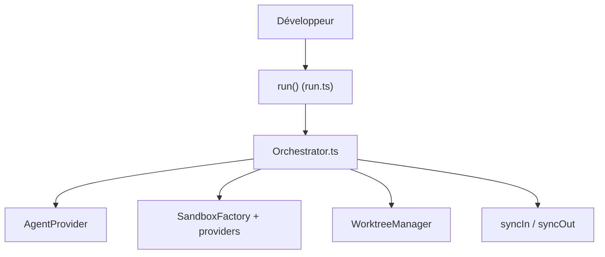

# mattpocock/sandcastle

> TypeScript library for running coding agents in isolated sandboxes, with commit merging.

## The problem
Running several coding agents in parallel on a repository without them overwriting each other or touching your machine.

## What it actually does
A single `sandcastle.run()` call creates a branch or a worktree, opens a sandbox, runs the agent, then merges the commits. Sandboxes: Bubblewrap, Seatbelt, Docker, Podman, and cloud (Daytona, E2B, Fly.io Sprites, Modal, Vercel). Structured outputs and resumed sessions.

## How it is wired


## Trying it
```bash
npm install
npm run build
npm test
npm run typecheck
```
Development commands; library usage points to the documentation.

## Cost and gotchas
The agents it calls use your own keys or subscriptions. Cloud providers are billed by their vendors.

## What it is not
Not an agent: it orchestrates the ones you supply. The README gives no user-side install command.

## Alternatives
No alternative named in the README.

## For you
Keep an eye on it: useful for parallelizing agents on a repository, but young and run by a single person.
