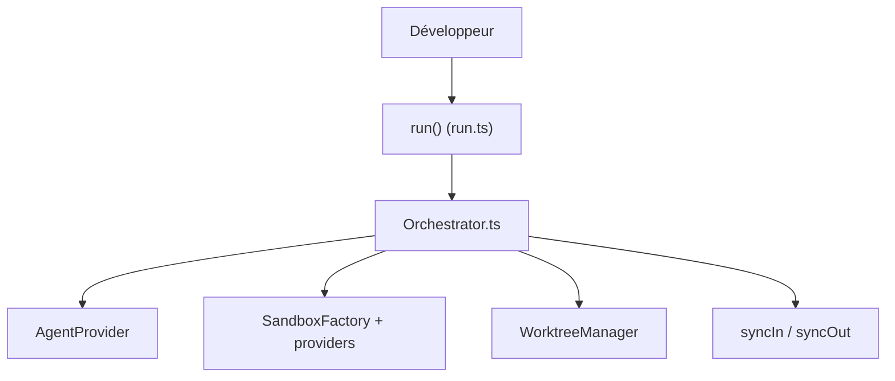

# mattpocock/sandcastle

> Bibliothèque TypeScript pour lancer des agents de code dans des bacs à sable isolés, avec fusion des commits.

## Le problème
Faire tourner plusieurs agents de code en parallèle sur un dépôt sans qu'ils s'écrasent ni touchent à ta machine.

## Ce que ça fait vraiment
Un appel `sandcastle.run()` crée une branche ou un worktree, ouvre un bac à sable, exécute l'agent, puis fusionne les commits. Sandboxes : Bubblewrap, Seatbelt, Docker, Podman, et cloud (Daytona, E2B, Fly.io Sprites, Modal, Vercel). Sorties structurées et sessions reprises.

## Comment c'est branché


## Essayer
```bash
npm install
npm run build
npm test
npm run typecheck
```
Commandes de développement ; l'usage en bibliothèque renvoie à la documentation.

## Coût et pièges
Les agents appelés utilisent tes propres clés ou abonnements. Les providers cloud sont facturés par leurs éditeurs.

## Ce que ce n'est pas
Pas un agent : il orchestre ceux que tu fournis. Le README ne donne pas de commande d'installation côté utilisateur.

## Alternatives
Aucune alternative nommée dans le README.

## Pour toi
Surveiller : utile pour paralléliser des agents sur un dépôt, mais jeune et porté par une seule personne.

