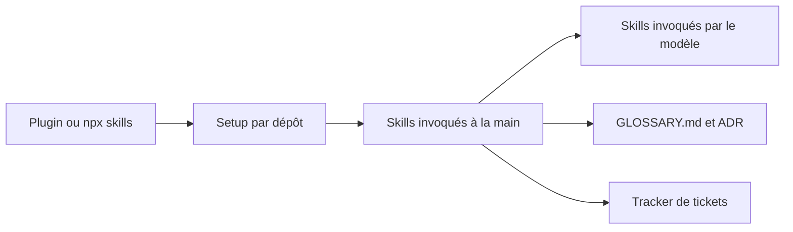

# mattpocock/skills

> A collection of coding skills, small and modular, designed for use with precision rather than intuition.

## The problem
Developers often misunderstand requirements, are verbose, produce code that doesn't work, and increase code entropy. Process frameworks (such as GSD, BMAD, and Spec-Kit) address this by taking control.

## What it actually does
Skills that can be invoked manually (`/grill-me`, `/grill-with-docs`, `/triage`, `/to-spec`, `/to-tickets`, `/implement`) and skills that the agent initiates on their own (`tdd`, `diagnosing-bugs`, `code-review`, `research`). `/grill-with-docs` prompts the user and builds a domain glossary and ADR. `/setup-matt-pocock-skills` configures the ticket tracker and labels, once per repository.

## How it is wired


## Trying it
```bash
claude plugin install mattpocock-skills@claude-plugins-official
npx skills@latest add mattpocock/skills -a <agent>
```

## Cost and gotchas
Free; the use of agent tokens is your responsibility. Do not install both the plugin and `skills.sh` together: each skill would be loaded twice.

## What it is not
This is not a framework that dictates your process; the author explicitly rejects this. It's not a miracle cure for architectural problems: `/improve-codebase-architecture` is a suggestion, not a solution.

## Alternatives
GSD, BMAD, and Spec-Kit: While they offer more direct guidance, they require more control.

## For you
To adopt: small, easily understood and adaptable skills that promote alignment and Test-Driven Development (TDD) are worth trying immediately, without locking down your workflow.
