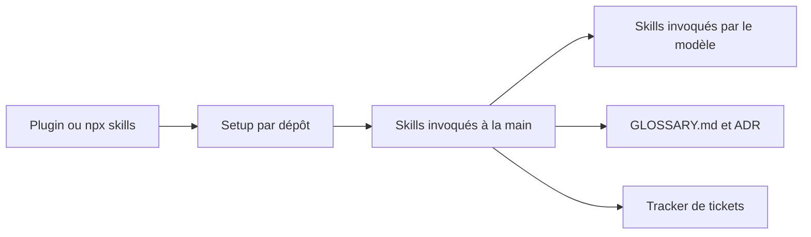

# mattpocock/skills

> Collection de skills d'agents de code, petites et composables, pour travailler avec rigueur plutôt qu'au feeling.

## Le problème
Les agents de code comprennent mal ce qu'on veut, sont verbeux, produisent du code qui ne marche pas et accélèrent l'entropie du code. Les frameworks de process (GSD, BMAD, Spec-Kit) règlent cela en prenant le contrôle.

## Ce que ça fait vraiment
Des skills à invoquer à la main (`/grill-me`, `/grill-with-docs`, `/triage`, `/to-spec`, `/to-tickets`, `/implement`) et des skills que l'agent déclenche seul (`tdd`, `diagnosing-bugs`, `code-review`, `research`). `/grill-with-docs` interroge l'utilisateur et construit un glossaire du domaine et des ADR. `/setup-matt-pocock-skills` configure le tracker de tickets et les labels, une fois par dépôt.

## Comment c'est branché


## Essayer
```bash
claude plugin install mattpocock-skills@claude-plugins-official
npx skills@latest add mattpocock/skills -a <agent>
```

## Coût et pièges
Gratuit ; la consommation de jetons de ton agent est à ta charge. Ne pas installer plugin et `skills.sh` ensemble : chaque skill serait chargé en double.

## Ce que ce n'est pas
Pas un framework qui pilote ton processus : l'auteur le refuse explicitement. Pas une cure miracle de l'architecture : `/improve-codebase-architecture` est un relevé, pas un sauvetage.

## Alternatives
GSD, BMAD et Spec-Kit : plus directifs, ils possèdent le process, au prix du contrôle.

## Pour toi
À adopter : de petits skills lisibles et adaptables qui imposent l'alignement et le TDD valent l'essai tout de suite, sans verrouiller ton flux de travail.

