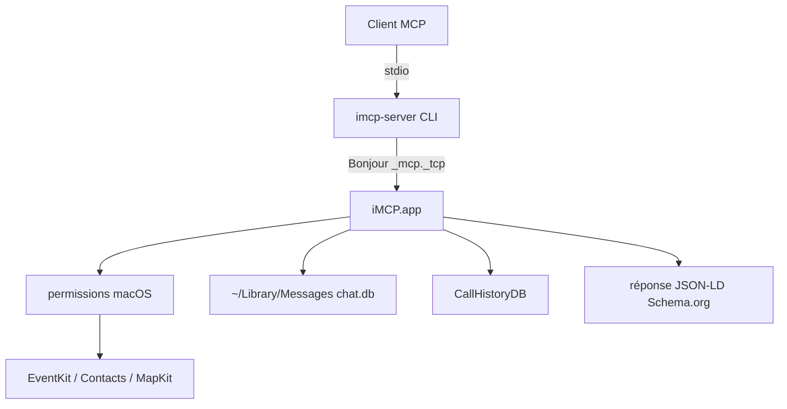

# mattt/iMCP

> macOS application that exposes calendar, contacts, messages and location to MCP clients.

## The problem
An AI assistant knows nothing about the agenda, contacts or call history of the machine it runs on.
Answering requires copying that data by hand into the conversation.

## What it actually does
Exposes nine services — Calendar, Contacts, Location, Maps, Messages, Phone, Reminders, Shortcuts, Weather — as MCP tools.
Each service is enabled individually and triggers the standard macOS permission dialog; the icons turn from gray to color.
Results are returned as JSON-LD based on the Schema.org vocabulary, via the Swift `Ontology` package.
Reads the iMessage `chat.db` database, asking for access to the **folder** `~/Library/Messages` to cover the WAL journal, without which recent messages are missing.

## How it is wired


## Trying it
```bash
brew install --cask mattt/tap/iMCP
claude mcp add --scope user iMCP -- /Applications/iMCP.app/Contents/MacOS/imcp-server
npx @modelcontextprotocol/inspector [commande-copiée]
```

## Cost and gotchas
macOS 15.3 minimum, so recent Apple hardware. Node.js only for the debugging inspector.
iMCP collects nothing, but the README states that clients such as Claude Desktop do send data off the device.

## What it is not
Not cross-platform: the app relies on Apple frameworks and the macOS sandbox.
Not a stable API for iMessage: Apple does not document this format, and the `typedstream` decoding is reverse-engineering taken from `imessage-exporter`.
Access granted to the `chat.db` file alone by an earlier version leaves new messages invisible until the next checkpoint.

## Alternatives
No alternative named in the README; `Companion` and the MCP Inspector are cited there as debugging tools, not as substitutes.

## For you
Irrelevant outside the Apple ecosystem, and exposing the iMessage database to a remote LLM requires an explicit decision.
