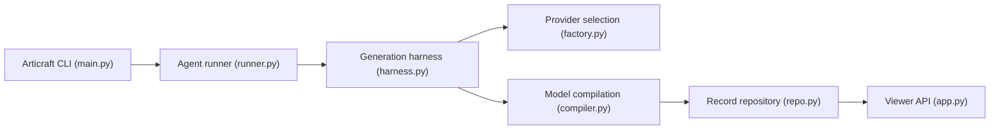

# mattzh72/articraft

> Generates articulated 3D models from a prompt, with viewer and SDK; repository replaced by a successor.

## The problem
Creating 3D objects with joints (hinges, arms) by hand for simulation or robotics is slow.

## What it actually does
- `articraft generate`: an LLM agent writes a `model.py` using the SDK, compiles it and saves the record.
- `articraft fork` to modify an existing object; generation from an image is possible.
- Local viewer (API and React frontend, URDF format); public dataset `mattzh72/articraft-data`.
- Providers: OpenAI, Gemini, Anthropic, DashScope; cost cap `--max-cost-usd`.

## How it is wired


## Trying it
```bash
just setup
uv run articraft generate "Create a realistic articulated desk lamp with a weighted base, two hinged arms, and an adjustable lamp head."
uv run articraft fork <record_id> "make the handle longer"
just viewer
```

## Cost and gotchas
Provider API keys at your expense. Python 3.12 recommended, 3.13 and above not supported. The generated code is executed: run it only from trusted sources. The repository is stated to be replaced by articraftresearch/Articraft.

## What it is not
Not a maintained repository: the README points to the new repository for current development.

## Alternatives
The README cites articraftresearch/Articraft, the replacement repository.

## For you
Worth watching via the successor repository: an interesting idea of an agent generating verifiable 3D code, but this repository is no longer the source.
